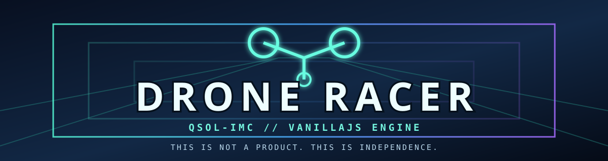

<strong>Race the void. Own the machine.</strong> 
An offline-first 6DOF drone racing demonstration built with pinned VANILLAJS engine modules.

<strong>This is not a product. This is INDEPENDENCE. 👽</strong>

<a href="https://qsolkcb.github.io/DRONE-RACER/"><strong>PLAY THE DEMO</strong></a> · <a href="docs/HOW_TO_PLAY.md">CONTROLS</a> · <a href="ROADMAP.md">ROADMAP</a> · <a href="docs/ARCHITECTURE.md">ARCHITECTURE</a>

## DRONE-002 — ALIEN MATH, custom drone packs and chase view

- **Gates now use reviewed VANILLAJS ALIEN MATH**: exact decimal-string course source, explicit `rounding:'exact', overflow:'reject'` Q16.16 compilation and widened BigInt swept checkpoint decisions.
- **Float64 flight remains unchanged**: an explicit IEEE-754 → checked Q16.16 truncation step is independently compared against Python `fractions.Fraction.from_float`. No cross-browser bit-exact flight claim.
- **Data-only local mod kit**: select Independence Scout or Spectral Wasp, import your own validated JSON track/drone pack (32 KiB limit), edit drone stats and colour, choose custom gate colours, or download a template. Unsupported code/assets are rejected.
- **Third-person chase camera**: use **View: Chase** or **T** to see a simple procedural quadrotor following the authoritative flight pose; FPV is still the default. Renderer never affects physics, timing or checkpoint eligibility.
- Separate best times per pack; original Independence Sprint best-time key is preserved.
- Source-pinned Apache-2.0 VANILLAJS arithmetic; updated independent tests, modding and game-creation guides.

[Play DRONE-RACER](https://qsolkcb.github.io/DRONE-RACER/) · [Mod/Reskin Guide](docs/MOD_GUIDE.md) · [Build your own drone game](docs/HOW_TO_MAKE_A_DRONE_GAME.md) · [ALIEN MATH contract](docs/ALIEN_MATH_DRONE_002.md) · [Upstream ALIEN Course Foundry](https://qsolkcb.github.io/VANILLAJS/demos/alien-course-lab/index.html)

**Scope:** The working Mod Kit is data-only, not the full future VANILLAJS Mod SDK. Longer looping tracks, arbitrary rotated hoops, realistic obstacles, sampled music and texture/mesh modding remain planned.

## Original DRONE-001 baseline (preserved)

- Six ordered neon gates with swept world-space checkpoint crossings, not screen-space guessing.
- Actual VANILLAJS 6DOF physics with assisted or inertial flight modes.
- Fixed 60 Hz simulation, tick-based time trial, local best time and focus-safe pause.
- Canvas 2D perspective renderer as a software-only, no-GPU-required baseline.
- Keyboard and simple on-screen touch controls; no accounts or network services to play.
- Allowlisted static packaging, SHA-256 verification and automated CI.

**Original baseline scope:** DRONE-001 did not include exact course adoption, mods or chase rendering. Those DRONE-002 additions are documented above; arbitrary 3D obstacles, custom textures/meshes, a general Mod SDK, AI rivals, universal deterministic replay, WebGPU/WASM acceleration, audio polish and online rankings remain unimplemented.

## Run locally

    uv run --no-project python -m http.server 8080 --bind 127.0.0.1

Visit `http://127.0.0.1:8080/`. You can disconnect the network after obtaining a local clone. Controls: W/S thrust, A/D strafe, Q/E elevation, arrows pitch/yaw, C/V roll, Space brake, M flight mode, P pause and R restart.

## Test and build

Node 22 is used only for development, not to play:

    node --test tests/*.test.js
    node scripts/site.mjs build _site
    node scripts/site.mjs verify _site

GitHub Actions checks pull requests and deploys the rebuilt site after successful `main` pushes, including merges. Manual deployment is restricted to `main`. Configure Settings → Pages → **Source: GitHub Actions**. Live URL: https://qsolkcb.github.io/DRONE-RACER/

## Build with us

See [ROADMAP.md](ROADMAP.md), [architecture](docs/ARCHITECTURE.md), [how to play](docs/HOW_TO_PLAY.md), [working mod guide](docs/MOD_GUIDE.md) and [verification contract](docs/VERIFICATION.md).

Reusable math/physics/render/SDK improvements belong in [VANILLAJS](https://github.com/QSOLKCB/VANILLAJS); game modes, courses, records and content belong here. Follow the practical [OFFLINE-GAMES](https://github.com/QSOLKCB/OFFLINE-GAMES) modding example.

**QSOL-IMC: Make amazing alien tech and put it under an Apache 2.0 license.**
